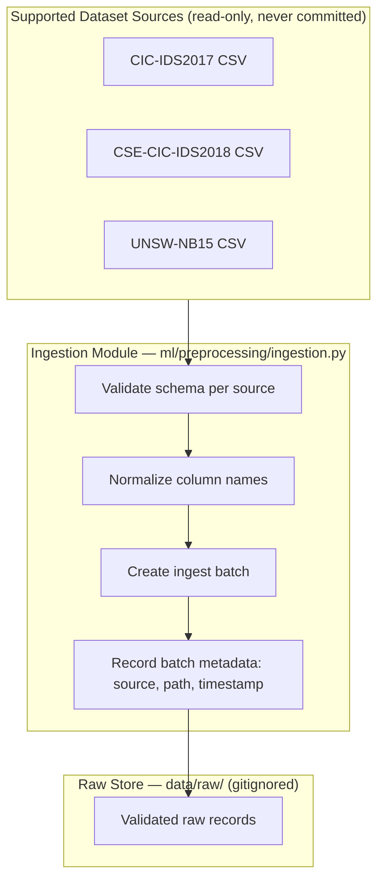
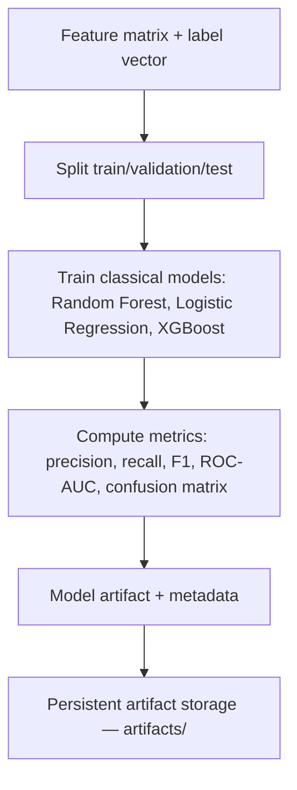

# Data Flow

This document describes how data moves through SentinelGraph, from raw dataset
ingestion to persisted predictions and incidents.

## 1. Dataset ingestion

Raw flow records arrive from one of the supported dataset sources
(CIC-IDS2017, CSE-CIC-IDS2018, UNSW-NB15). Each source is validated against its
declared schema before being persisted to the raw store.



### Data contract — Ingestion → Raw Store

| Field | Type | Constraint |
|-------|------|------------|
| `batch_id` | UUID | Generated per ingest run |
| `source` | enum | `{CIC-IDS2017, CSE-CIC-IDS2018, UNSW-NB15}` |
| `file_path` | string | Path to source file |
| `ingested_at` | timestamp | Ingest time |
| `record_count` | int | Number of records validated |
| `schema_version` | string | Declared schema version for the source |

## 2. Preprocessing and feature engineering

Validated raw records are cleaned, normalized, encoded, and split into a
reproducible feature matrix.

```mermaid
flowchart TD
    RAW[Raw validated records] --> CLEAN[Clean: handle missing values (drop/impute)]
    CLEAN --> NUM[Normalize numeric features]
    NUM --> CAT[Encode categorical features]
    CAT --> SPLIT[Train/validation/test split (fixed seed)]
    SPLIT --> FM[Feature matrix + label vector]
    FM --> ART[Persist feature artifacts to artifacts/]
```

### Data contract — Raw Store → Feature Matrix

| Field | Type | Constraint |
|-------|------|------------|
| `feature_matrix` | 2D array | Rows = flows, columns = features |
| `label_vector` | 1D array | One label per flow (or null for anomaly-only mode) |
| `feature_names` | list[string] | Ordered feature names |
| `split_seed` | int | Fixed random seed for reproducibility |
| `scaler_params` | object | Normalization parameters (mean/std or min/max) |
| `label_vocabulary` | list[string] | Dataset-specific attack-family labels |

## 3. Graph construction

Flow records are materialized as a directed graph: nodes are unique IP
addresses, edges are communication flows. Nodes carry aggregated statistics;
edges carry per-flow features.

```mermaid
flowchart TD
    FLOW[Flow records] --> NODES[Extract nodes: unique IP addresses]
    FLOW --> EDGES[Extract edges: src IP → dst IP per flow (directed)]
    NODES --> NF[Node features: aggregated flow statistics per IP]
    EDGES --> EF[Edge features: per-flow features]
    NF & EF --> GRAPH[Graph object: nodes = IPs, edges = flows]
    GRAPH --> GS[Persist graph to data/graphs/ (gitignored)]
```

### Data contract — Feature Matrix → Graph Object

| Component | Type | Constraint |
|-----------|------|------------|
| `nodes` | list | Each node = unique IP address |
| `node_features` | 2D array | Aggregated statistics per IP (byte/packet totals, flow count, ...) |
| `edges` | list of (src, dst) | Directed; one edge per flow record |
| `edge_features` | 2D array | Per-flow features aligned to `edges` |
| `edge_labels` | 1D array | Optional label per edge (benign/malicious or attack family) |
| `node_id_map` | dict | IP address → node index |

**Important:** SentinelGraph performs **edge-level (flow-level) classification**,
not node classification. Nodes are structural entities (IPs); the prediction
target is each edge/flow. See `graph-architecture.md`.

## 4. Classical ML training

The feature matrix is split and used to train classical models.



### Data contract — Feature Matrix → Model Artifact

| Field | Type | Constraint |
|-------|------|------------|
| `model_id` | UUID | Unique per training run |
| `model_type` | enum | `{random_forest, logistic_regression, xgboost}` |
| `hyperparameters` | object | Model configuration |
| `metrics` | object | Precision, recall, F1, ROC-AUC per class |
| `artifact_path` | string | Path in `artifacts/` |
| `trained_at` | timestamp | Training completion time |
| `source_dataset` | enum | Dataset used for training |

## 5. PyTorch Geometric (GNN) training

The graph object is converted to a PyG `Data` object and used to train an
edge-level GNN classifier.

```mermaid
flowchart TD
    GRAPH[Graph object] --> PYG[PyTorch Geometric Data object]
    PYG --> SPLIT[Edge train/validation/test split (edge mask)]
    SPLIT --> GNN[GNN edge classifier: GCN / GAT / GraphSAGE]
    GNN --> METRICS[Edge-level metrics: precision, recall, F1, ROC-AUC]
    METRICS --> ARTIFACT[GNN model artifact + metadata]
    ARTIFACT --> AS[Persistent artifact storage — artifacts/]
```

### Data contract — Graph Object → GNN Model Artifact

| Field | Type | Constraint |
|-------|------|------------|
| `model_id` | UUID | Unique per training run |
| `model_type` | enum | `{gcn, gat, graphsage}` |
| `task` | enum | `{edge_classification}` |
| `hyperparameters` | object | GNN configuration |
| `edge_metrics` | object | Edge-level precision, recall, F1, ROC-AUC |
| `artifact_path` | string | Path in `artifacts/` |
| `trained_at` | timestamp | Training completion time |

## 6. Inference data flow

At inference time, a single flow record is converted to edge features, scored by
the loaded model, optionally fused with an anomaly score, and explained.

```mermaid
flowchart TD
    FLOW[Incoming flow record] --> EF[Extract edge features]
    EF --> MODEL[Load trained model from artifacts/]
    MODEL --> SCORE[Threat score in [0,1] + label]
    ANOM[Anomaly model] --> ASCORE[Anomaly score]
    SCORE --> FUSE[Score fusion]
    ASCORE --> FUSE
    FUSE --> OUT[Prediction record: label, score, anomaly flag]
    OUT --> EXP[Explainer: SHAP / GNNExplainer]
    EXP --> EA[Explanation artifact linked to prediction ID]
```

### Data contract — Inference Request → Response

| Field | Type | Constraint |
|-------|------|------------|
| `flow_id` | UUID | Request identifier |
| `src_ip` | string | Source IP |
| `dst_ip` | string | Destination IP |
| `edge_features` | array | Per-flow feature vector |
| `label` | enum | `{benign, malicious}` or attack family |
| `score` | float | Threat score in [0, 1] |
| `anomaly_flag` | boolean | Anomaly detection flag |
| `explanation_id` | UUID | Reference to explanation artifact |
| `model_id` | UUID | Model version used |

## 7. Threat correlation and persistence

Predictions are grouped into incidents, scored, and persisted in PostgreSQL.

```mermaid
flowchart TD
    PRED[Predictions] --> GROUP[Group by shared IP + time window + attack family]
    GROUP --> INC[Incident]
    INC --> RISK[Risk score in [0,100], deterministic formula]
    RISK --> PERSIST[Persist incident in PostgreSQL]
```

### Data contract — Incident Record

| Field | Type | Constraint |
|-------|------|------------|
| `incident_id` | UUID | Unique incident identifier |
| `start_time` | timestamp | First related prediction |
| `end_time` | timestamp | Last related prediction |
| `entities` | list[string] | Involved IP addresses |
| `attack_families` | list[string] | Attack families present |
| `risk_score` | float | Risk score in [0, 100] |
| `prediction_ids` | list[UUID] | Linked predictions |

## Module responsibilities (data flow)

| Module | Responsibility | Input | Output |
|--------|---------------|-------|--------|
| `ml/preprocessing/ingestion.py` | Validate and batch raw dataset records | Raw CSV/Parquet | Validated raw records + batch metadata |
| `ml/preprocessing/cleaning.py` | Missing-value handling | Raw records | Cleaned records |
| `ml/feature_engineering/normalization.py` | Feature normalization + encoding | Cleaned records | Normalized + encoded features |
| `ml/feature_engineering/splitting.py` | Deterministic train/val/test split | Feature matrix | Split indices |
| `ml/graph_learning/graph_construction.py` | Build directed IP→flow graph | Flow records | Graph object (nodes/edges/features) |
| `ml/classical_models/training.py` | Train classical classifiers | Feature matrix + splits | Model artifact + metrics |
| `ml/graph_learning/gnn_training.py` | Train GNN edge classifier | Graph object + edge mask | GNN model artifact + metrics |
| `ml/anomaly_detection/scoring.py` | Compute anomaly scores | Flow records | Anomaly score per flow |
| `ml/explainability/explain.py` | Generate SHAP / GNNExplainer artifacts | Prediction + model | Explanation artifact |
| `ml/evaluation/metrics.py` | Compute task-specific metrics | Predictions + labels | Metrics report |
| `apps/api` | Serve /predict, /incidents endpoints | Inference request | JSON response |
| `apps/dashboard` | Render metrics, incidents, explanations | API responses | UI views |
