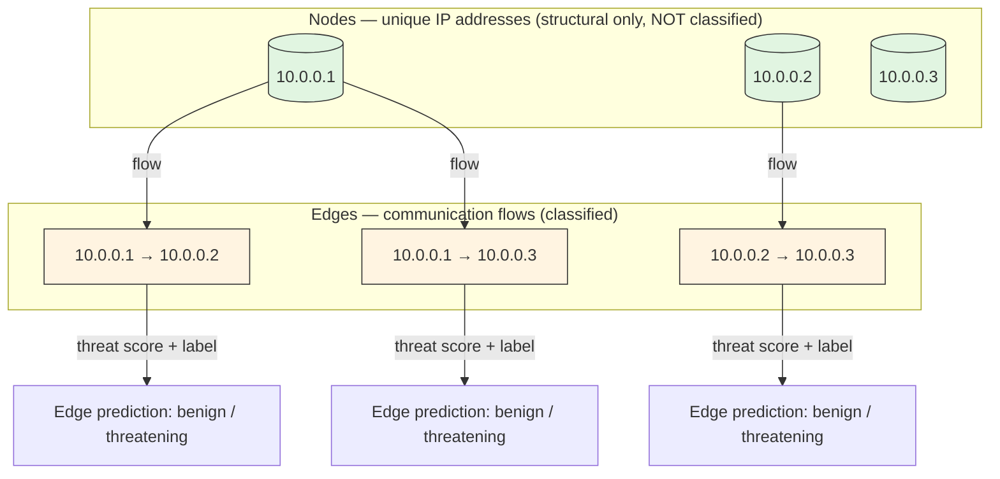
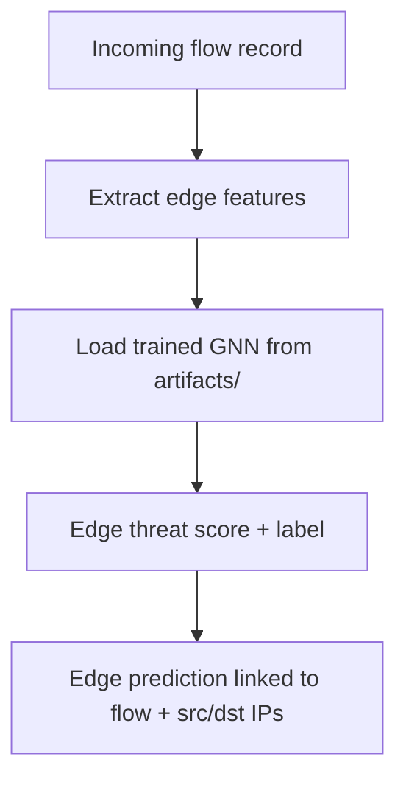

# Graph Architecture

This document describes the graph-level architecture of SentinelGraph. It is
critical to understand that SentinelGraph performs **edge-level (flow-level)
classification**, not node classification.

## 1. Core principle: edges are flows, nodes are IPs

Network traffic is relational: every communication is a flow from a source IP to
a destination IP. SentinelGraph models this as a directed graph:

- **Nodes** = unique IP addresses (structural entities only).
- **Edges** = communication flows (directed: `src_ip → dst_ip`).
- **Node features** = aggregated statistics per IP (byte/packet totals, flow count, distinct peers, ...).
- **Edge features** = per-flow features (duration, bytes, packets, protocol, flags, ...).
- **Edge labels** = threat label per flow (benign/malicious or attack family).

**The prediction target is the edge/flow, not the node.** A node (IP address) is
never assigned a threat class. Threat scores and labels are produced per edge.



### Node vs. edge classification — explicit distinction

| Aspect | Node classification | Edge/flow classification (SentinelGraph) |
|--------|---------------------|------------------------------------------|
| Prediction target | Node (IP address) | Edge (communication flow) |
| Output per node | Threat class for the IP | Threat score/label for the flow |
| Used by SentinelGraph | ❌ No | ✅ Yes |
| Node role | Structural context (aggregated stats) | Not classified |

## 2. Graph construction

```mermaid
flowchart TD
    FLOW[Flow records] --> NODES[Extract nodes: unique IP addresses]
    FLOW --> EDGES[Extract edges: src IP → dst IP per flow (directed)]
    NODES --> NF[Node features: aggregated flow statistics per IP]
    EDGES --> EF[Edge features: per-flow features]
    NF & EF --> GRAPH[Graph object: nodes = IPs, edges = flows]
    GRAPH --> GS[Persist graph to data/graphs/ (gitignored)]
```

### Data contract — Graph object

| Component | Type | Constraint |
|-----------|------|------------|
| `nodes` | list[string] | Unique IP addresses |
| `node_index_map` | dict | IP address → integer node index |
| `node_features` | 2D array | Shape `[num_nodes, num_node_features]` |
| `edges` | list[tuple[int, int]] | Directed `(src_index, dst_index)` pairs |
| `edge_features` | 2D array | Shape `[num_edges, num_edge_features]` |
| `edge_labels` | 1D array | Optional threat label per edge |
| `num_nodes` | int | Count of unique IPs |
| `num_edges` | int | Count of flow records |

## 3. PyTorch Geometric representation

The graph object is materialized as a PyG `Data` object:

- `x`: node feature matrix `[num_nodes, num_node_features]`
- `edge_index`: `[2, num_edges]` directed source/destination indices
- `edge_attr`: edge feature matrix `[num_edges, num_edge_features]`
- `y`: edge label vector `[num_edges]` (optional)
- `train_mask` / `val_mask` / `test_mask`: boolean edge masks `[num_edges]`

Masks are edge-level (not node-level), reflecting that classification happens per
edge.

## 4. GNN training — edge-level

A GNN (GCN / GAT / GraphSAGE) consumes node features and edge features to
produce an edge-level threat prediction. Message passing aggregates information
across the graph so that an edge's prediction can be informed by its endpoints'
neighborhood context, but the output remains a per-edge threat score.

```mermaid
flowchart TD
    PYG[PyG Data object] --> MESSAGE[Message passing over edges]
    MESSAGE --> EDGE_ENC[Edge encoder combines endpoint + edge features]
    EDGE_ENC --> SCORE[Edge threat score in [0,1]]
    SCORE --> LOSS[Binary/multiclass loss on labeled edges]
    LOSS --> UPDATE[Backpropagate through GNN weights]
```

## 5. Edge-level prediction at inference



## 6. Major architectural trade-offs (graph)

| Trade-off | Decision | Rationale |
|-----------|----------|-----------|
| Edge vs. node classification | **Edge-level** | Threats are flows; classifying IPs as nodes would misrepresent the detection target and conflate benign/compromised hosts sharing an IP. |
| Directed edges | **Directed** (`src→dst`) | Preserves flow directionality, which is semantically meaningful for intrusion detection (e.g., inbound vs. outbound). |
| Node features | **Aggregated flow stats** | Provides per-IP context without classifying the IP itself; supports GNN message passing. |
| Graph persistence | **Per-dataset graph files** | Graphs are large and dataset-specific; stored under `data/graphs/` (gitignored), rebuilt deterministically from flow records. |

## Module responsibilities (graph)

| Module | Responsibility | Input | Output |
|--------|---------------|-------|--------|
| `ml/graph_learning/graph_construction.py` | Build directed IP→flow graph with node/edge features | Flow records | Graph object |
| `ml/graph_learning/pyg_conversion.py` | Convert graph object to PyG `Data` with edge masks | Graph object | PyG `Data` object |
| `ml/graph_learning/gnn_models.py` | GCN / GAT / GraphSAGE edge classifier definitions | PyG `Data` | Edge threat logits |
| `ml/graph_learning/gnn_training.py` | Train GNN edge classifier | PyG `Data` + masks | GNN model artifact + metrics |
