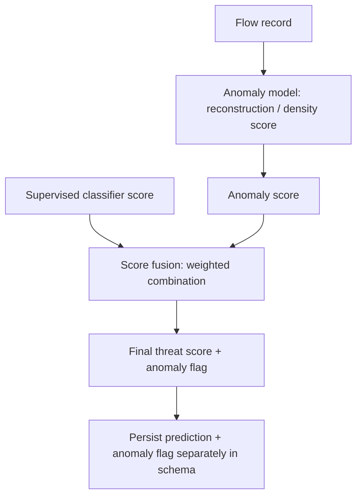

# ML Pipeline

This document describes the end-to-end machine learning pipeline: classical ML
training, PyTorch Geometric (GNN) training, edge-level prediction, anomaly
detection and score fusion, and explainable AI.

## Environments (explicitly distinguished)

| Environment | Role | Network access | Artifact destination |
|-------------|------|----------------|----------------------|
| **Source code** | GitHub repository containing pipeline code. | Optional (clone/install) | N/A |
| **Training environment** | Kaggle (Kaggle Kernels) or local equivalent; runs training scripts offline. | Offline during training | `artifacts/` |
| **Persistent artifact storage** | `artifacts/` — model weights, metrics, explanations (gitignored). | N/A | Read by inference |
| **Inference runtime** | Independent FastAPI application runtime; loads models from `artifacts/`. | Offline | N/A |

## 1. Classical ML training pipeline

Tabular flow features are used to train non-graph classifiers.

```mermaid
flowchart TD
    FM[Feature matrix + label vector] --> SPLIT[Split train/validation/test (fixed seed)]
    SPLIT --> TRAIN[Train: Random Forest, Logistic Regression, XGBoost]
    TRAIN --> METRICS[Metrics: precision, recall, F1, ROC-AUC, confusion matrix]
    METRICS --> ARTIFACT[Model artifact + metadata: model_id, hyperparameters, trained_at]
    ARTIFACT --> AS[Persistent artifact storage — artifacts/]
```

### Pipeline steps

1. **Split:** deterministic train/validation/test split using `split_seed`.
2. **Train:** one model per algorithm (RF, LR, XGBoost) on the training split.
3. **Evaluate:** compute per-class and macro metrics on the held-out test split.
4. **Persist:** write model artifact and metrics JSON to `artifacts/` with `model_id`.

### Data contract — Classical model artifact

| Field | Type | Constraint |
|-------|------|------------|
| `model_id` | UUID | Unique per run |
| `algorithm` | enum | `{random_forest, logistic_regression, xgboost}` |
| `task` | enum | `{binary_classification, multiclass_classification}` |
| `hyperparameters` | object | Algorithm configuration |
| `metrics` | object | Test-split metrics |
| `artifact_path` | string | Relative path under `artifacts/` |
| `source_dataset` | enum | `{CIC-IDS2017, CSE-CIC-IDS2018, UNSW-NB15}` |
| `trained_at` | timestamp | Training completion time |

## 2. PyTorch Geometric (GNN) training pipeline

Flow graphs are converted to PyG `Data` objects and used to train an
**edge-level** GNN classifier.

```mermaid
flowchart TD
    GRAPH[Graph object] --> PYG[PyG Data object: x=node features, edge_index, edge_attr]
    PYG --> SPLIT[Edge train/validation/test split (edge mask)]
    SPLIT --> GNN[GNN edge classifier: GCN / GAT / GraphSAGE]
    GNN --> METRICS[Edge-level metrics: precision, recall, F1, ROC-AUC]
    METRICS --> ARTIFACT[GNN model artifact + metadata]
    ARTIFACT --> AS[Persistent artifact storage — artifacts/]
```

### Pipeline steps

1. **Convert:** materialize graph object into a PyG `Data` object
   (`x` node features, `edge_index`, `edge_attr` edge features, `y` edge labels).
2. **Split:** deterministic edge-level train/validation/test split via edge mask.
3. **Train:** GNN edge classifier (GCN/GAT/GraphSAGE) predicting edge threat label.
4. **Evaluate:** edge-level metrics on held-out test edges.
5. **Persist:** write model artifact and metrics to `artifacts/`.

### Data contract — GNN model artifact

| Field | Type | Constraint |
|-------|------|------------|
| `model_id` | UUID | Unique per run |
| `architecture` | enum | `{gcn, gat, graphsage}` |
| `task` | enum | `{edge_classification}` |
| `hyperparameters` | object | GNN configuration (layers, hidden dims, lr, ...) |
| `edge_metrics` | object | Edge-level test-split metrics |
| `artifact_path` | string | Relative path under `artifacts/` |
| `source_dataset` | enum | Dataset used |
| `trained_at` | timestamp | Training completion time |

## 3. Edge-level prediction

Each flow record is scored as an edge threat.

```mermaid
flowchart TD
    FLOW[Incoming flow record] --> EF[Extract edge features]
    EF --> MODEL[Load trained edge classifier from artifacts/]
    MODEL --> SCORE[Edge threat score in [0, 1] + label]
    SCORE --> OUT[Edge prediction record linked to flow + src/dst IPs]
```

### Data contract — Edge prediction

| Field | Type | Constraint |
|-------|------|------------|
| `flow_id` | UUID | Request identifier |
| `src_ip` / `dst_ip` | string | Flow endpoints |
| `edge_features` | array | Per-flow feature vector |
| `label` | enum | `{benign, threatening}` or attack family |
| `score` | float | Threat score in [0, 1] |
| `model_id` | UUID | Model version used |

**Note:** predictions are made per edge/flow, not per node. Nodes (IPs) are not
classified.

## 4. Anomaly detection and score fusion

An unsupervised anomaly model produces an anomaly score per flow, which is
fused with the supervised classifier score.



### Data contract — Anomaly output

| Field | Type | Constraint |
|-------|------|------------|
| `flow_id` | UUID | Flow identifier |
| `anomaly_score` | float | Unsupervised anomaly score |
| `anomaly_flag` | boolean | Thresholded anomaly decision |
| `fusion_weights` | object | Weights used for score fusion |
| `final_score` | float | Fused threat score |

The anomaly flag and supervised label remain distinct fields in the output
schema so they can be audited separately.

## 5. Explainable AI (SHAP and GNNExplainer)

Every prediction served through the API is accompanied by an explanation.

```mermaid
flowchart TD
    PRED[Prediction (classical or GNN)] --> EXP[Explainer: SHAP or GNNExplainer]
    EXP --> EA[Explanation artifact: feature importance / explanation subgraph]
    EA --> LINK[Link to prediction ID, model version, input record]
    LINK --> STORE[Persist explanation reference]
```

### Data contract — Explanation artifact

| Field | Type | Constraint |
|-------|------|------------|
| `explanation_id` | UUID | Unique explanation identifier |
| `prediction_id` | UUID | Linked prediction |
| `model_id` | UUID | Model version used |
| `explainer` | enum | `{shap, gnnexplainer}` |
| `attribution` | object | Feature importance or subgraph |
| `created_at` | timestamp | Explanation generation time |

## 6. Module responsibilities (ML pipeline)

| Module | Responsibility | Input | Output |
|--------|---------------|-------|--------|
| `ml/classical_models/training.py` | Train RF / LR / XGBoost classifiers | Feature matrix + splits | Model artifact + metrics |
| `ml/graph_learning/gnn_training.py` | Train GCN / GAT / GraphSAGE edge classifier | PyG Data + edge mask | GNN model artifact + metrics |
| `ml/anomaly_detection/scoring.py` | Compute unsupervised anomaly scores | Flow records | Anomaly score + flag |
| `ml/evaluation/fusion.py` | Fuse supervised + anomaly scores | Scores | Final threat score |
| `ml/explainability/explain.py` | Generate SHAP / GNNExplanation artifacts | Prediction + model | Explanation artifact |
| `ml/evaluation/metrics.py` | Compute task-specific metrics | Predictions + labels | Metrics report |

## 7. Major architectural trade-offs

| Trade-off | Decision | Rationale |
|-----------|----------|-----------|
| Edge vs. node classification | **Edge-level classification** | Network threats are flows (edges), not hosts (nodes). Nodes (IPs) provide graph structure only. |
| Classical vs. GNN | **Both, independently** | Classical models give strong tabular baselines; GNNs capture relational structure. Each is trained and evaluated separately. |
| Training environment | **Kaggle** | Kaggle-first strategy keeps training offline and reproducible; source code lives on GitHub. |
| Artifact storage | **Persistent local `artifacts/`** | Decouples training from inference; inference reads models without re-training. |
| Anomaly fusion | **Weighted score fusion** | Combines supervised confidence with unsupervised anomaly signal; weights configurable and logged. |
| Offline-first | **No internet at inference** | Enables air-gapped SOC deployment; all model artifacts pre-staged in `artifacts/`. |
