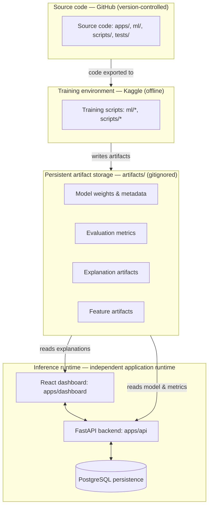

# System Overview

SentinelGraph is an offline-first network threat detection platform that models
network traffic as a graph and applies graph neural networks (GNNs) alongside
classical ML models for binary/multiclass intrusion detection, edge-level threat
classification, anomaly detection, and explainable AI.

## 1. High-level component boundaries

The system is divided into four independently configurable boundaries:

| Boundary | Responsibility | Location | Lifecycle |
|----------|---------------|----------|-----------|
| **Source code** | All application, ML, and infrastructure source code. | `GitHub` (this repository) | Version-controlled; developed locally and in CI. |
| **Training environment** | Model training, hyperparameter search, and evaluation runs. | `Kaggle` (Kaggle Kernels / local equivalent) | Runs offline; reads source code from GitHub; writes artifacts only. |
| **Persistent artifact storage** | Trained model weights, metrics, explanations, and feature artifacts. | `artifacts/` (persistent local storage, gitignored) | Read by training (write) and inference (read); never committed. |
| **Inference runtime** | Serves predictions, incidents, and explanations via API; hosts dashboard. | Independent application runtime (`apps/api` FastAPI + `apps/dashboard` React) | Reads models from persistent artifact storage; no internet access required at inference time. |

These boundaries are intentionally decoupled: training never writes to the
inference runtime directly, and inference never trains. The only shared medium is
the persistent artifact storage.

## 2. Guiding principles

- **Offline-first:** after dependency installation, training, inference, API, and
  dashboard operate without external network services.
- **Determinism:** identical inputs, seed, hyperparameters, and code produce
  identical model artifacts and metrics.
- **No secrets committed:** credentials, datasets, checkpoints, and weights are
  never committed to GitHub (enforced by `.gitignore`).
- **Edge-level, not node-level:** the graph models communication flows as edges;
  nodes (IP addresses) provide structure only. See `graph-architecture.md`.
- **Independently configurable:** backend (`apps/api`) and frontend
  (`apps/dashboard`) are separately packaged and configurable.

## 3. Environment matrix

| Environment | Technology | Network access | Git-tracked? |
|-------------|-----------|----------------|--------------|
| Development | Local Python + Node | Optional (for installs only) | Yes |
| Training | Kaggle Kernels / local | Offline during training | No (source only) |
| Inference | FastAPI + React | Offline | Yes |
| Persistence | PostgreSQL | Offline | No (runtime data) |
